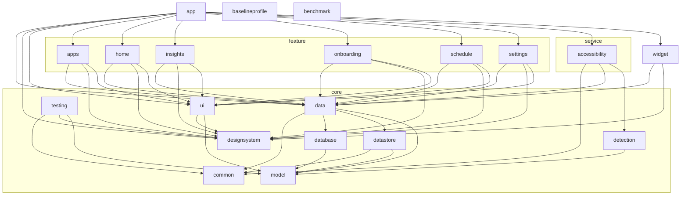

# Unreel

**Block the feed, not the app.** Unreel is an Android app that stops Instagram Reels and YouTube Shorts
from pulling you into endless scrolling, while DMs, search, normal videos and uploads keep working.

> **Status:** early development. See the [roadmap](#roadmap) and the
> [milestones](https://github.com/uveshm003/unreel-android/milestones). Not on Google Play yet.

## Try the debug MVP

The debug APK includes an opt-in Shorts blocker for YouTube **21.18.164** (Android version code `1561170057`). After onboarding, **Apps** checks the installed YouTube build against the bundled detection rule. Unsupported builds show their installed version and build number. On a supported install, tap **Set up Shorts protection**, read the disclosure, and choose **I agree**. Open Android accessibility settings and enable **Unreel Shorts protection**. The Apps screen shows when the service connects. Return to Apps and tap **Turn off Shorts protection** to stop blocking.

The preview presses Back when it recognises the Shorts player. It skips other YouTube versions. The Instagram, Pause, Budget and allow-one controls currently save preferences for later implementation. This preview runs locally and reads structural identifiers and bounds. It discards snapshots after evaluating the window.

Build with `./gradlew assembleDebug` or download `unreel-debug-apk` from the integration PR’s CI run. [Integration PR and builds](https://github.com/uveshm003/unreel-android/pull/86)

## Why

App blockers fail because you still need the rest of those apps. Unreel uses an Android
AccessibilityService to recognise only the short-form feed surface (the Reels tab, the Shorts player, a
reel opened from a DM or link) and steps in there. Everything else in the app is left alone.

## Features (v1)

- **Feed detection engine.** Detection rules are versioned JSON data, built from real UI dumps and tested
  against sanitised positive *and* negative fixtures (home feed, stories, DMs, explore, normal videos).
- **Per-app protection level:** Off, **Pause** (10-second breathing countdown, then "Go back" or
  "Allow 5 min"), **Budget** (N minutes a day, then hard block) or **Hard block** (bounce out of the feed).
- **"Allow one, block the scroll".** A reel someone sends you plays; swiping to the next one doesn't.
- **Schedules** that raise protection during time windows (e.g. hard block 22:00–07:00).
- **Commitment lock** for 1 / 4 / 12 / 24 h: protection can be raised but not lowered. Honest about its
  limits: Android always lets you turn off an accessibility service, and Unreel never pretends otherwise.
- **Insights:** time in short-form feeds, interventions, scrolls avoided, streaks and an *estimate* of
  time reclaimed.
- **Home-screen widget** and a **Quick Settings tile**.
- **Guided setup:** prominent disclosure and consent, restricted-settings help for sideloaded APKs,
  battery-optimisation and OEM autostart guidance.
- English and Hindi.

## Privacy

Unreel is **on-device only**.

- No `INTERNET` permission. CI fails the build if the merged release manifest ever requests it.
- No analytics, crash reporting SDKs, accounts, ads or backend.
- The accessibility service only listens to the supported apps. It reads view IDs, class names and
  content descriptions to recognise a feed. Nothing read from the screen is stored or logged, apart from
  the minimum needed for detection (which surface is showing and for how long).
- "Report a detection problem" opens a pre-filled GitHub issue in your browser. You see and edit
  everything before anything is sent, and Unreel itself sends nothing.

## Roadmap

| Milestone | Goal | Release |
|---|---|---|
| M0 Foundation | Design system, adaptive app shell, test infrastructure, architecture docs | — |
| M1 Detection engine | Rules-as-data engine, fixtures from real devices, accessibility service, hard block | `v0.1.0` |
| M2 Interventions & control | Protection levels, pause overlay, budgets, schedules, commitment lock, onboarding | `v0.2.0` |
| M3 Insights & surfaces | Session tracking, insights charts, home dashboard, widget, QS tile, export | `v0.3.0` |
| M4 Hardening & release | Performance audit, baseline profile, resilience, Play readiness | `v1.0.0` |
| M5 Stretch | Facebook Reels, Snapchat Spotlight | — |

## Build

Requirements: JDK 17+ (CI uses 25), Android SDK with platform `android-37.2`.

```sh
./gradlew assembleDebug            # build the debug APK
./gradlew installDebug             # install on a connected device
./gradlew spotlessApply ciCheck    # the exact gate CI runs: format, detekt, lint, tests, screenshots,
                                   # Kover coverage and the no-INTERNET privacy check
./gradlew recordRoborazziDebug     # re-record screenshot goldens after an intended UI change
```

## Architecture

Kotlin, Jetpack Compose (Material 3), Hilt, Coroutines/Flow, Room, DataStore, WorkManager, type-safe
Navigation Compose and kotlinx.serialization. UI → domain → data, with unidirectional data flow. The
detection engine (`:core:detection`) is pure Kotlin and fully unit-tested; the accessibility service
is a thin adapter around it. Details: [docs/architecture.md](docs/architecture.md) and the decision
records in [docs/adr/](docs/adr/).

<!-- module-graph:start -->

<!-- module-graph:end -->

## Contributing

Every change goes through an issue, a pull request and a review. See [CONTRIBUTING.md](CONTRIBUTING.md).

## License

[Apache-2.0](LICENSE)
