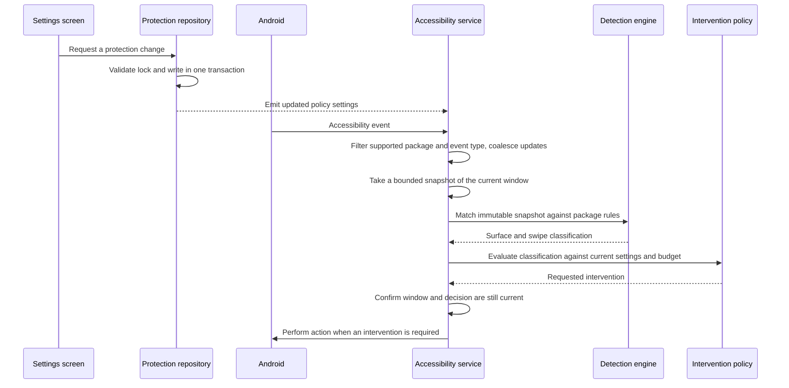
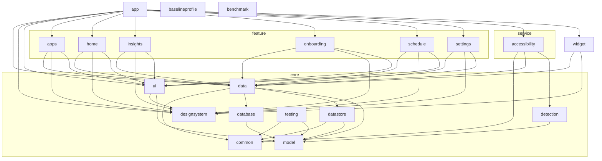

# Architecture

Unreel is a single-activity Compose app plus an AccessibilityService. Everything runs on the device; there
is no network access (see the privacy check in `build-logic`). This page is the map. Decisions and their
reasons live in [ADRs](adr/).

## Layers

```
UI (Compose screens + ViewModels, :feature:*)            one StateFlow<UiState> per ViewModel
   │  user actions are functions, one-off effects via Channel
   ▼
Domain (use cases only where they add value)
   ▼
Data (:core:data repositories)                           the single source of truth for each kind of data
   ▼
Sources (:core:database Room, :core:datastore DataStore, platform managers)
```

## Detection pipeline

The following sequence describes the planned service. Feature screens and the service share the same
repository contracts. A change to the Apps screen therefore reaches the next policy decision without
restarting the service.



### Threading and lifetime

The main-thread callback filters events and schedules a snapshot. Read live accessibility nodes on
the service thread and copy only the fields detection needs before handing the snapshot to the
injected computation dispatcher. The engine consumes ordinary Kotlin values. Apply platform actions
on the main thread. If the window or package changes while matching is in flight, discard the stale
result. Cancel outstanding jobs and settings collection when the service disconnects.

Repositories expose flows backed by Room and DataStore. The service collects protection settings once
per connection and holds the latest snapshot in memory. Wait for the initial settings before acting.
An event callback can then evaluate policy without a disk read. A rejected settings edit leaves the
previous policy in effect. Session recording and aggregation use asynchronous database operations.

## Modules

| Module | Responsibility |
|---|---|
| `:app` | Activity, navigation host, Hilt application, debug tooling (StrictMode, LeakCanary) |
| `:core:common` | Dispatchers, result types, `Clock`; pure Kotlin |
| `:core:model` | Plain data types shared across layers; pure Kotlin |
| `:core:detection` | Feed detection engine: `NodeSnapshot` + rules (JSON) → `DetectedSurface`; pure Kotlin, ≥ 80 % coverage |
| `:core:database` | Room database (protection policy, feed sessions, aggregates); schemas exported to `core/database/schemas` |
| `:core:datastore` | DataStore for preferences and setup progress |
| `:core:data` | Repositories over the sources above |
| `:core:designsystem` | Material 3 theme, typography, core components |
| `:core:ui` | Shared composables that know about the model |
| `:core:testing` | Test support: dispatcher rule, fakes, screenshot helpers |
| `:service:accessibility` | The AccessibilityService, snapshot builder, overlays and actions |
| `:feature:*` | Screens + ViewModels: onboarding, home, apps, schedule, insights, settings |
| `:widget` | Glance widget and Quick Settings tile |
| `:baselineprofile`, `:benchmark` | Baseline Profile generator and macro/microbenchmarks (device only) |

Rules: features never depend on other features. `:core:detection`, `:core:common` and `:core:model` have no
Android dependencies. Build configuration lives in `build-logic/` convention plugins, never copied between
modules.

<!-- module-graph:start -->

<!-- module-graph:end -->

Regenerate the graph with `python3 scripts/module-graph.py` after changing module dependencies (`ciCheck`
fails if it is out of date).

## Quality gates

`./gradlew ciCheck` is exactly what CI runs: Spotless (ktlint + Compose rules), Detekt, Android Lint
(errors fail), unit and Robolectric tests, Roborazzi screenshot verification, Kover (≥ 80 % for pure
Kotlin modules, ≥ 60 % overall), the module-graph check and the no-`INTERNET` check on the merged release
manifest.
