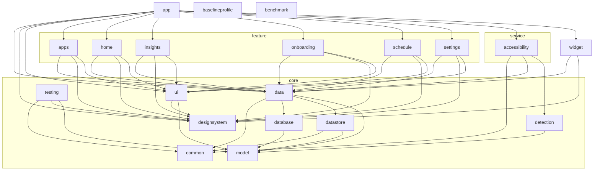

# Architecture

Unreel is a single-activity Compose app plus an AccessibilityService. Everything runs on the device; there
is no network access (see the privacy check in `build-logic`). This page is the map. Decisions and their
reasons live in [ADRs](adr/).

## Layers

```
UI (Compose screens + ViewModels, :feature:*)            one StateFlow<UiState> per ViewModel
   │  user actions are functions, one-off effects via Channel
   ▼
Domain (use cases only where they add value)
   ▼
Data (:core:data repositories)                           the single source of truth for each kind of data
   ▼
Sources (:core:database Room, :core:datastore DataStore, platform managers)
```

The accessibility side follows the same rule: **the service is thin.**

```
AccessibilityEvent ──► :service:accessibility ──► NodeSnapshot ──► :core:detection ──► DetectedSurface
   (filtered by package     builds a capped,            (pure Kotlin,            + isSwipeToNext
    and event type,         debounced snapshot          rules are JSON data)          │
    debounced)                                                                        ▼
                         action executor ◄── injected policy (protection level, budget, schedule, lock)
                         (BACK / overlay)
```

## Modules

| Module | Responsibility |
|---|---|
| `:app` | Activity, navigation host, Hilt application, debug tooling (StrictMode, LeakCanary) |
| `:core:common` | Dispatchers, result types, `Clock`; pure Kotlin |
| `:core:model` | Plain data types shared across layers; pure Kotlin |
| `:core:detection` | Feed detection engine: `NodeSnapshot` + rules (JSON) → `DetectedSurface`; pure Kotlin, ≥ 80 % coverage |
| `:core:database` | Room database (feed sessions, aggregates); schemas exported to `core/database/schemas` |
| `:core:datastore` | DataStore for settings |
| `:core:data` | Repositories over the sources above |
| `:core:designsystem` | Material 3 theme, typography, core components |
| `:core:ui` | Shared composables that know about the model |
| `:core:testing` | Test support: dispatcher rule, fakes, screenshot helpers |
| `:service:accessibility` | The AccessibilityService, snapshot builder, overlays and actions |
| `:feature:*` | Screens + ViewModels: onboarding, home, apps, schedule, insights, settings |
| `:widget` | Glance widget and Quick Settings tile |
| `:baselineprofile`, `:benchmark` | Baseline Profile generator and macro/microbenchmarks (device only) |

Rules: features never depend on other features. `:core:detection`, `:core:common` and `:core:model` have no
Android dependencies. Build configuration lives in `build-logic/` convention plugins, never copied between
modules.

<!-- module-graph:start -->

<!-- module-graph:end -->

Regenerate the graph with `python3 scripts/module-graph.py` after changing module dependencies (`ciCheck`
fails if it is out of date).

## Quality gates

`./gradlew ciCheck` is exactly what CI runs: Spotless (ktlint + Compose rules), Detekt, Android Lint
(errors fail), unit and Robolectric tests, Roborazzi screenshot verification, Kover (≥ 80 % for pure
Kotlin modules, ≥ 60 % overall), the module-graph check and the no-`INTERNET` check on the merged release
manifest.
